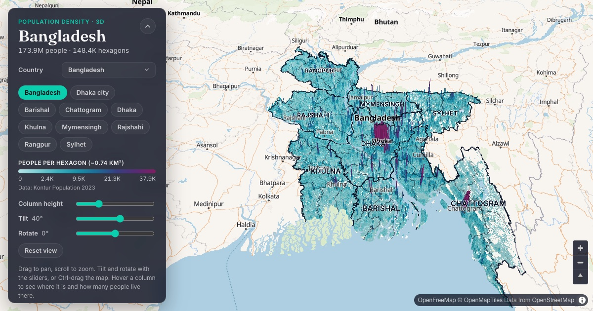
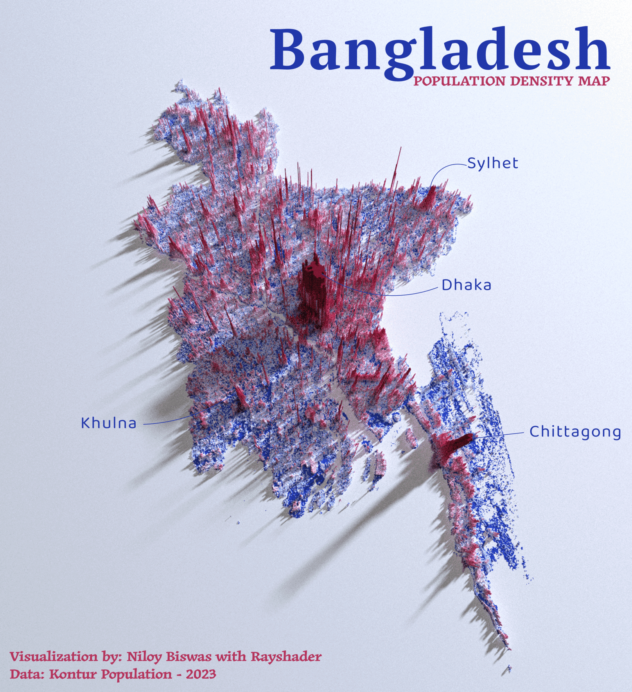
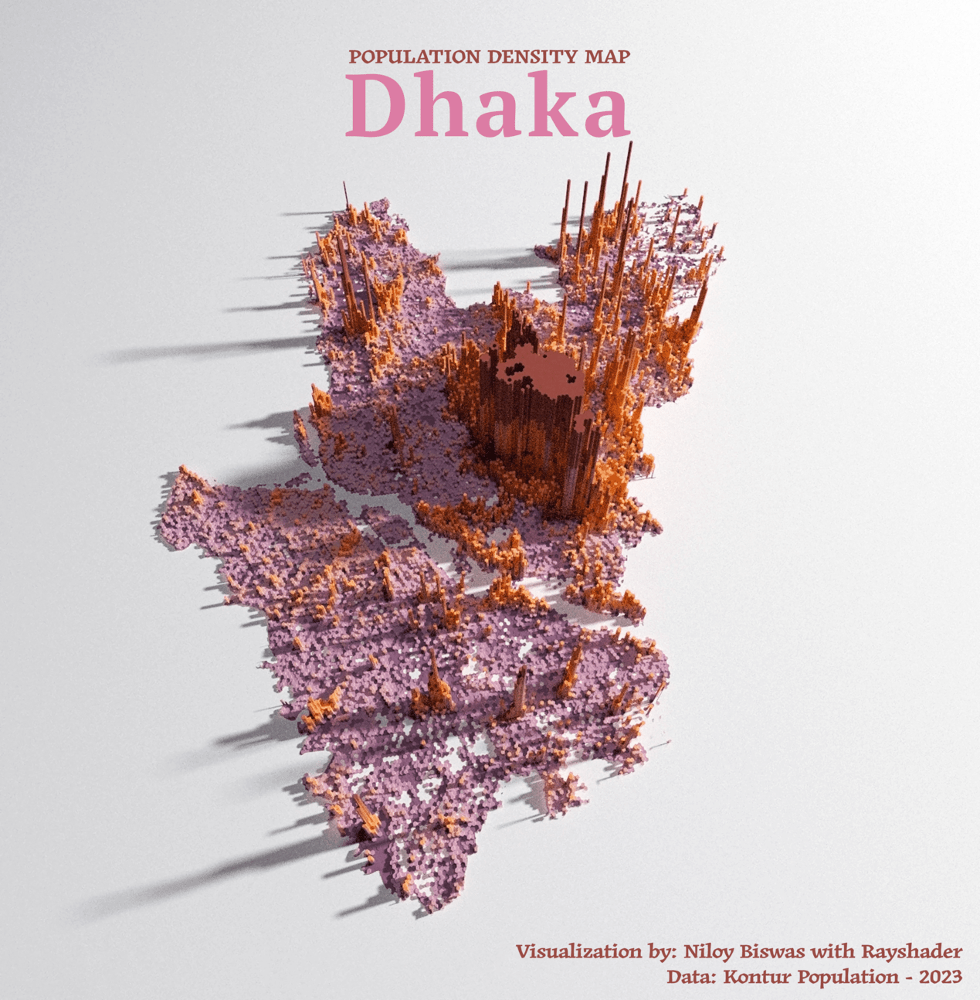
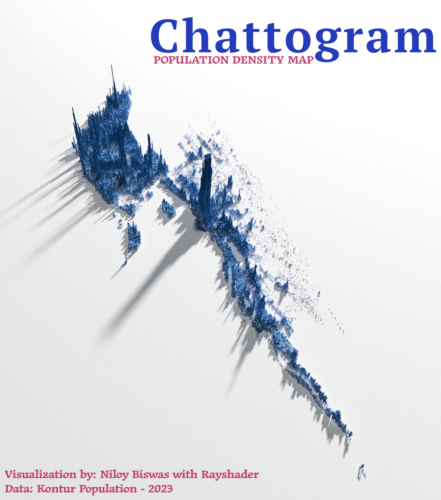
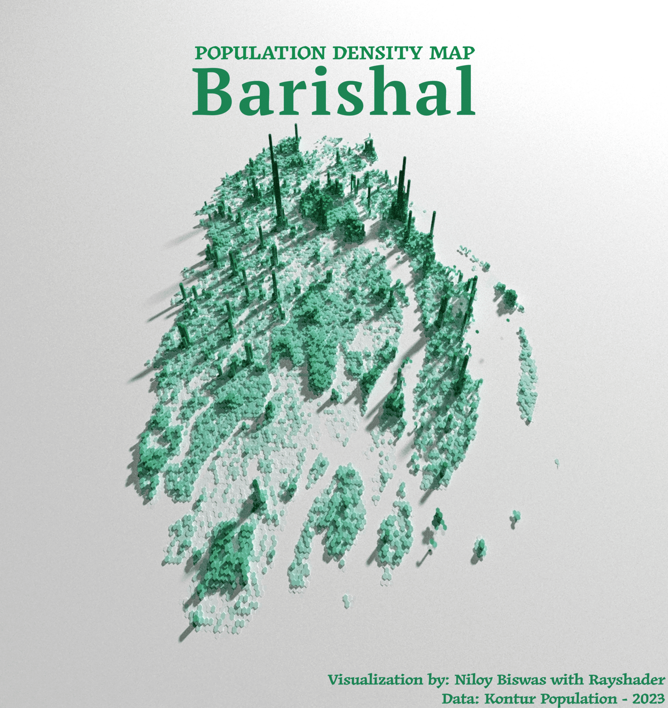
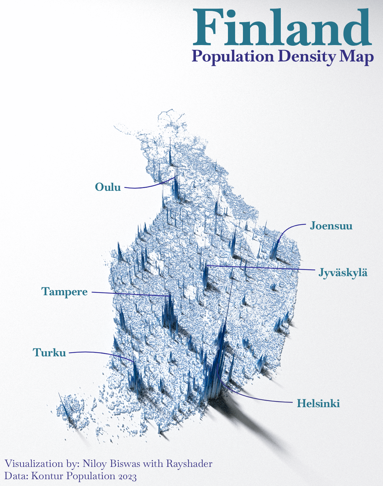

# Population Density Map

3D population density maps from Kontur population data, in two forms:

- **Rendered maps**: ray-traced images made in R with Rayshader (gallery below).
- **[Interactive explorer](https://niloy.tech/Population-Density-Map/)**: the same hexagons as 3D columns in the browser. Pick a country, fly between its regions, tilt the view and hover any column for its location and people per km². 33 countries are live, from Bangladesh and Pakistan to most of Europe, Japan and Nigeria; more plug in with one download and one export command.

[](https://niloy.tech/Population-Density-Map/)

Both read the same country list in `scripts/countries.R`, but they run independently: making a rendered map never touches `web/`, and the explorer never needs Rayshader.

## Project Structure

```
Population/
├── run_country.R          # Entry point for rendered maps
├── scripts/
│   ├── countries.R        # All country configs (both outputs read this)
│   ├── helpers.R          # Palette creation utilities
│   ├── create_pop_matrix.R
│   ├── plot_population_3d.R
│   ├── annotate_population_map.R
│   ├── export_web_data.R  # Country data → web/data/ for the explorer
│   ├── download_kontur.R  # Fetch Kontur files by ISO code into data/kontur/
│   ├── setup_packages.R   # Run once to install dependencies
│   └── legacy/            # Old per-country scripts (reference only)
├── data/                  # Kontur .gpkg population + boundary files
│   └── kontur/            # Downloaded by download_kontur.R (gitignored)
├── output/
│   ├── plots/             # Raw 3D renders
│   └── annotated/         # Final annotated maps
├── web/                   # Interactive explorer (static, deployed to GitHub Pages)
│   ├── index.html, app.js, style.css
│   └── data/
│       ├── countries.json # Countries in the picker (generated)
│       └── <country>/     # hexes.json + boundaries.geojson (generated)
└── .github/workflows/pages.yml  # Deploys web/ on push to main
```

## Setup

**1. Install R**
Download from [cran.r-project.org](https://cran.r-project.org) (v4.4+)

**2. Install XQuartz** (macOS only — required for rgl)
Download from [xquartz.org](https://www.xquartz.org), install, then restart Mac.

**3. Install R packages**
Open `scripts/setup_packages.R` and run it once.

## Running a Map

Open `run_country.R`, uncomment the country you want, and source the file:

```r
run_country("bangladesh")
# run_country("finland")
# run_country("india")
# ... etc
```

Output saves automatically to `output/annotated/<Country>_population_density.png`.

## Adding a New Country

1. Download the [Kontur](https://data.humdata.org/organization/kontur) population and boundary files by ISO 3166 code:

   ```bash
   Rscript scripts/download_kontur.R GB DE    # → data/kontur/
   ```

   This fetches `kontur_population_XX_20231101.gpkg` and `kontur_boundaries_XX_20230628.gpkg` from Kontur's public bucket (the same files HDX links to) and skips files you already have. `data/kontur/` is gitignored: some files are over GitHub's 100 MB limit, and a fresh clone can re-download them.

2. Add a config block to `scripts/countries.R`:

```r
my_country = list(
  name       = "My Country",
  hex_file   = "data/kontur/kontur_population_XX_20231101.gpkg",
  admin_file = "data/kontur/kontur_boundaries_XX_20230628.gpkg",
  crs        = 3857,        # find at epsg.io
  size       = 3000,
  palette    = list(source = "metbrewer", name = "Benedictus", direction = -1),
  zscale     = 40,
  camera     = list(theta = 0, phi = 55, zoom = 0.75, fov = 100),
  light_dir  = 315,
  width      = 1400, height = 1800,
  solid      = FALSE, shadow_depth = 0
)
```

3. Uncomment in `run_country.R`:

```r
run_country("my_country")
```

See the comment block at the top of `scripts/countries.R` for what each parameter does.

## Web Explorer

`web/` is a static page with no build step. [deck.gl](https://deck.gl) draws each Kontur H3 hexagon (about 0.74 km²) as a 3D column over a [MapLibre](https://maplibre.org) basemap from [OpenFreeMap](https://openfreemap.org). The page reads `web/data/countries.json` to fill the country picker, then loads one country's folder at a time. Links are shareable: `#bangladesh`, `#bangladesh/dhaka-city`.

`scripts/export_web_data.R` writes that data. For each country it:

- tags every hexagon with its subdistrict, district and region (for the hover tooltip)
- turns the country, its regions and any extra presets into view buttons
- writes region and district outlines and labels, clipped to land: Kontur's boundaries include sea areas, so they are cut to Natural Earth land plus the populated hexagons

```bash
Rscript scripts/export_web_data.R bangladesh          # one country
Rscript scripts/export_web_data.R bangladesh nepal    # several
```

Each run rebuilds `countries.json` from the folders in `web/data/`, so the picker always matches what's exported.

**Preview locally:** `python3 -m http.server -d web`, then open [localhost:8000](http://localhost:8000).

**Publish:** push changes under `web/` to `main`. The workflow deploys them to [niloy.tech/Population-Density-Map](https://niloy.tech/Population-Density-Map/).

### Adding a country to the explorer

1. Make sure the country has a block in `scripts/countries.R` with `hex_file` and `admin_file` (see [Adding a New Country](#adding-a-new-country)). The export only reads `name`, those two files and the optional `web` settings. A block with just those is enough for the explorer (most of the newer countries are like this); `run_country()` refuses it until you add the Rayshader fields.

2. Check which Kontur admin levels it uses. They differ between countries:

   ```r
   a <- sf::st_read("data/kontur/kontur_boundaries_XX_20230628.gpkg")
   table(a$admin_level)
   ```

   | Country        | region | district | subdistrict |
   |----------------|--------|----------|-------------|
   | Austria        | 4      | 8        | 9           |
   | Bangladesh     | 4      | 6        | 8, 10       |
   | Belgium        | 4      | 7        | 9           |
   | Bhutan         | 4      | 6        | none        |
   | Czechia        | 7      | 8        | 9           |
   | Denmark        | 4      | 8        | none        |
   | Finland        | 6      | 7        | 8           |
   | France         | 5      | 6        | 8           |
   | Germany        | 4      | 7        | 10          |
   | Greece         | 5      | 6        | 9           |
   | Hungary        | 6      | 7        | 9           |
   | Ireland        | 6      | 10       | 11          |
   | Italy          | 4      | 7        | 9           |
   | Japan          | 5      | 9        | 10          |
   | Maldives       | 4      | none     | 9           |
   | Myanmar        | 3      | 7        | 9           |
   | Nepal          | 3      | 7        | 8           |
   | Netherlands    | 5      | 10       | 12          |
   | Nigeria        | 4      | 7        | 9           |
   | Norway         | 4      | 8        | none        |
   | Pakistan       | 3      | 6        | 7           |
   | Poland         | 4      | 8        | 9           |
   | Portugal       | 4, 7   | 8        | 10          |
   | Romania        | 4      | none     | 9           |
   | Singapore      | 7      | none     | none        |
   | Spain          | 4      | 7        | 9           |
   | Sri Lanka      | 4      | 6        | 7           |
   | Sweden         | 4      | 8        | none        |
   | Switzerland    | 4      | 8        | 11          |
   | Ukraine        | 4      | 6        | 7           |
   | United Kingdom | 4      | 7        | 10          |

   Use `character(0)` for a tier the file lacks. The Israel and Palestine boundary files carry no area names, so those maps show the columns and the country view without region buttons, outlines or place names.

   The defaults are Bangladesh's. For anything else, add a `web` list to the country's block:

   ```r
   nepal = list(
     ...
     web = list(levels = list(region = "3", district = "7", subdistrict = "8"))
   )
   ```

   `web` also takes `views` (extra camera presets, like Bangladesh's "Dhaka city"), `palette` (column colours) and `crop` (a lon/lat box; hexagons and areas outside it are dropped). France, the Netherlands, Norway and the UK use `crop` to leave out overseas territories, Svalbard and Rockall, which would otherwise stretch the country view across oceans. `bounds` sets only the first (country) view and keeps everything else: Spain, Portugal and Japan use it so the Canaries, Azores, Madeira and Okinawa stay on the map (with their own region buttons) without shrinking the mainland. See the comment at the top of `countries.R`.

3. Export it, preview, and push:

   ```bash
   Rscript scripts/export_web_data.R nepal
   ```

To remove a country, delete its `web/data/<country>/` folder and run the export for any remaining country to rebuild the index.

Countries range from under 50 KB of JSON (Maldives, Singapore) to about 18 MB (France, Nigeria, each around 600k hexagons); GitHub Pages compresses the largest to about 3.3 MB as served. Continent-sized countries (USA, China, India, Brazil, Russia) have 1 to 4 million hexagons at this size, too many for a browser, so they need coarser hexagons before they can be added.

## Maps

## Bangladesh



## Dhaka



## Chittagong



## Barishal



## India


## Nepal


## Bhutan


## Sri Lanka


## Myanmar


## Maldives


## Israel


## Palestine


## Israel & Palestine


## Finland



## Contributing

Fork the repo, add your country config to `scripts/countries.R`, and submit a pull request.
